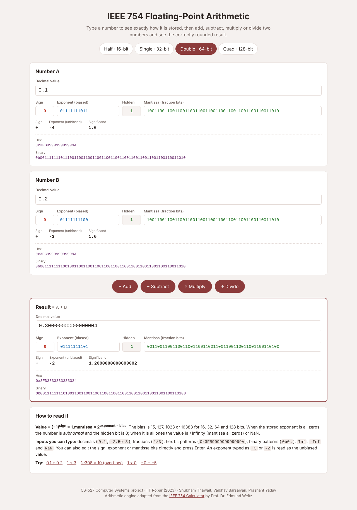

# IEEE 754 Floating-Point Arithmetic Calculator

An interactive web page for exploring **IEEE 754 binary floating point**. Type a number to see its sign, exponent and mantissa bits, its hex and binary encoding, and its decoded value. Then add, subtract, multiply or divide two numbers and see the correctly rounded result in **half (16-bit), single (32-bit), double (64-bit) and quadruple (128-bit)** precision.

Course project for **CS-527 Computer Systems, IIT Ropar (2023)**, under the guidance of **Prof. Neeraj Goel**.
Team: Shubham Thawait, Vaibhav Barsaiyan, Prashant Yadav.

> **Credits and permission:** the arithmetic engine (`js/IEEE.js`, `js/Fraction.js`, `js/code.js`) is adapted from the
> **[IEEE 754 Calculator](https://weitz.de/ieee/) by Prof. Dr. Edmund Weitz** (© 2016–2023). Permission was obtained
> from the original author to redistribute the adapted code under the MIT License. See [LICENSE](LICENSE) and
> [THIRD_PARTY_NOTICES.md](THIRD_PARTY_NOTICES.md) for attribution and licensing details.



## Features

- **Four precisions:** binary16, binary32, binary64 and binary128
- **Many input forms:** decimals (`0.1`, `-2.5e-3`), fractions (`1/3`), raw bit patterns (`0x3FB999999999999A`, `0b…`), `Inf`, `-Inf` and `NaN`
- **Editable bit fields:** change the sign, exponent or mantissa bits directly and watch the value update
- **Arithmetic:** +, −, ×, ÷, rounded to nearest with ties to even
- **Special values:** signed zero, subnormal numbers, overflow to ±Infinity, and NaN (for example `Inf − Inf` and `0 ÷ 0`)
- **Shortest decimal output:** the Burger & Dybvig algorithm prints the shortest decimal string that maps back to the same bits

## How it works

1. Each input is parsed into an **exact rational number** using BigInt-based fractions.
2. The operation is carried out exactly on those rationals, so no intermediate rounding happens.
3. The exact result is then **encoded once** into the selected format: normalised into [1, 2), with the exponent biased, the significand bits extracted, and rounding to nearest-even applied. It overflows to ±Inf, or becomes subnormal and then zero when too small.
4. The bits are decoded back and displayed as a decimal, hex and binary value.

This gives the same results as IEEE 754 hardware, because a single correctly rounded operation is exactly what the standard requires.

## Verification

The page was tested against the CPU's own floating-point arithmetic. For **3,200 random operand pairs**, covering all four operations in 64-bit (compared with JavaScript `Number`) and 32-bit (compared with `Math.fround`) and including subnormals, the computed bit patterns matched **exactly**. Spot checks in 16-bit and 128-bit also matched (e.g. half-precision 0.1 + 0.2 = `0x34CC`, 65504 × 2 = Inf).

## Changes made in this version

The submitted 2023 version had several bugs that stopped advertised features from working. This version fixes them:

| Problem in the 2023 copy | Fix |
|---|---|
| Page crashed on load: `code.js` wires up a **Division** button and 16/32/128-bit buttons that did not exist in the HTML | Added all four operation buttons and all four precision buttons |
| The only precision button was labelled "Double precision" but had the ID for **32-bit** | Labels and IDs now match; the active precision is highlighted |
| **Division** and any **subnormal** number threw `val.div is not a function`, because `Fraction.div` was missing | Added `Fraction.prototype.div` |
| `(-0) + (-5)` returned `-0`: missing `()` in `summand2.isZero` | Fixed the signed-zero check |
| Favicon used an absolute path (`/fpa.jpeg`), which breaks on GitHub Pages | Relative path |
| Table-based layout with duplicate `style` attributes and an invalid font stack; not usable on mobile | New responsive layout with colour-coded sign, exponent and mantissa fields, and a "How to read it" panel with one-click examples |

## Project structure

```
IEEE754-FPA-Calculator/
├── index.html            # Page layout (element IDs are used by js/code.js)
├── css/style.css
├── js/
│   ├── Fraction.js       # Exact rational arithmetic on BigInt
│   ├── IEEE.js           # Encoding, decoding, parsing, shortest decimal output
│   └── code.js           # Page logic and the four operations
├── assets/favicon.jpeg
└── docs/
    ├── project-report.pdf
    ├── presentation-representation.pptx
    ├── presentation-arithmetic.pptx
    └── screenshots/
```

## Run locally

No build step or install is needed. Open `index.html` in any modern browser.

## License

This project is distributed under the MIT License. See [LICENSE](LICENSE) for the license text and [THIRD_PARTY_NOTICES.md](THIRD_PARTY_NOTICES.md) for third-party attribution.
